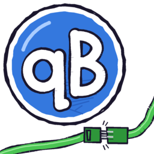
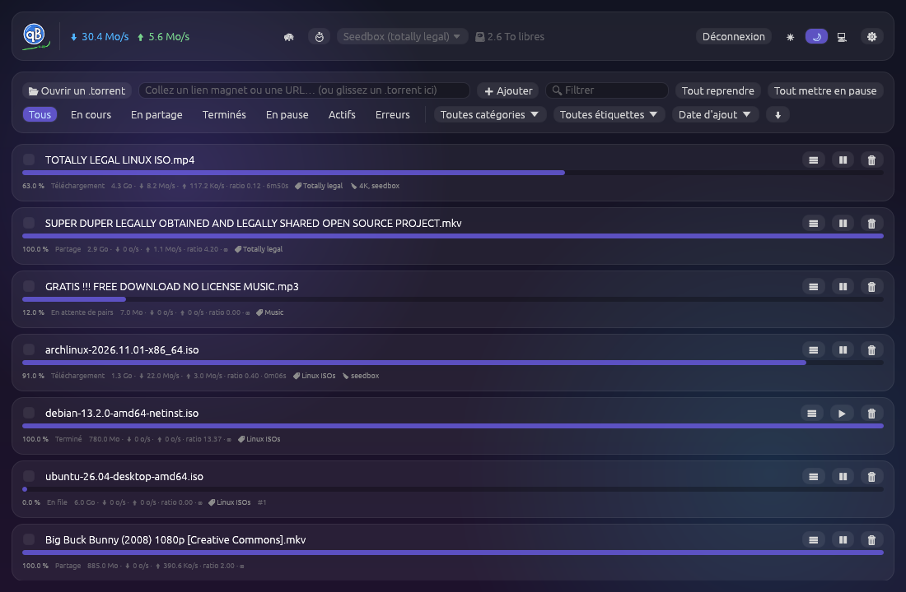
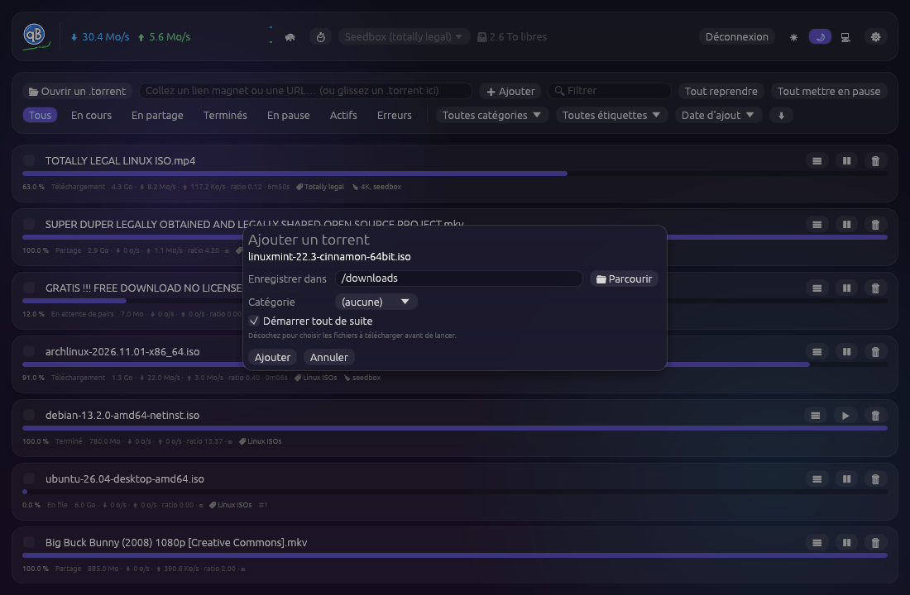
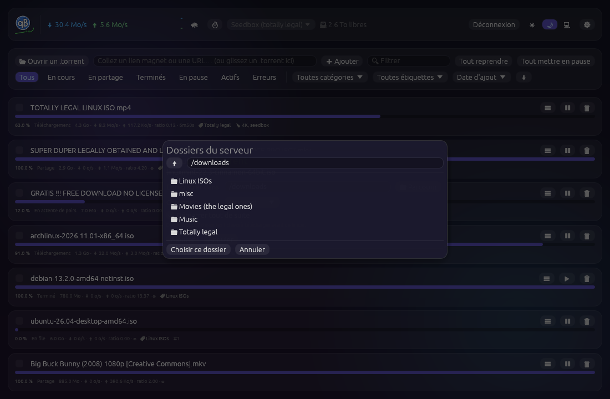
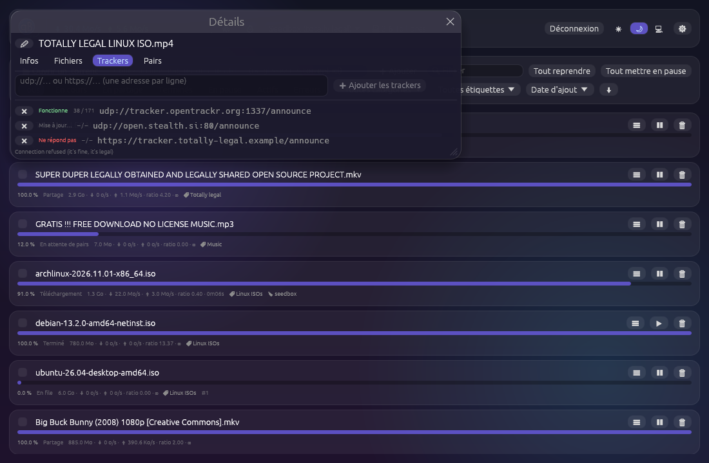
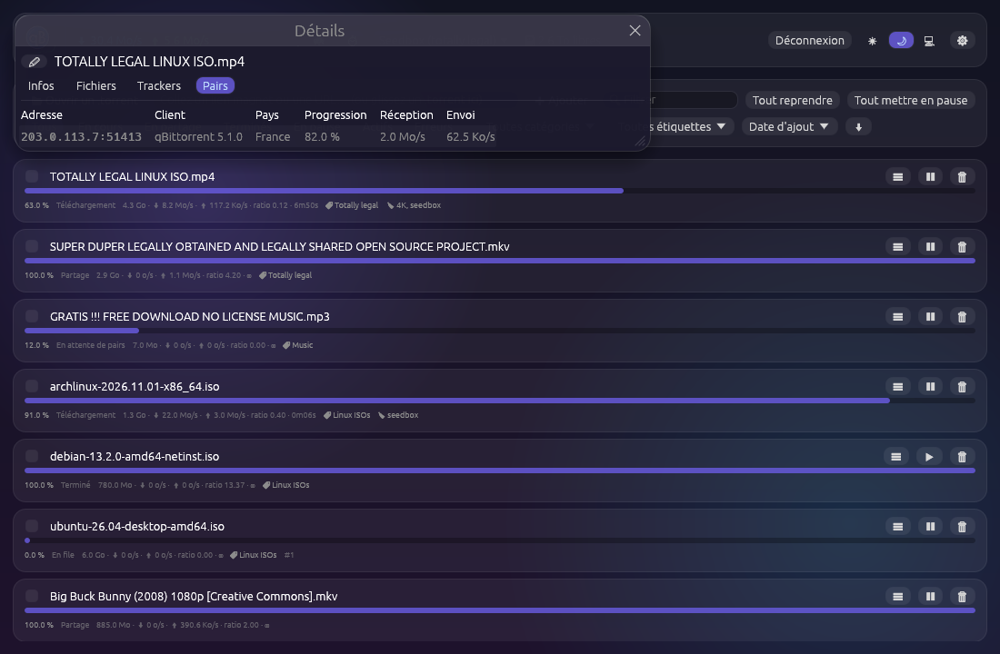
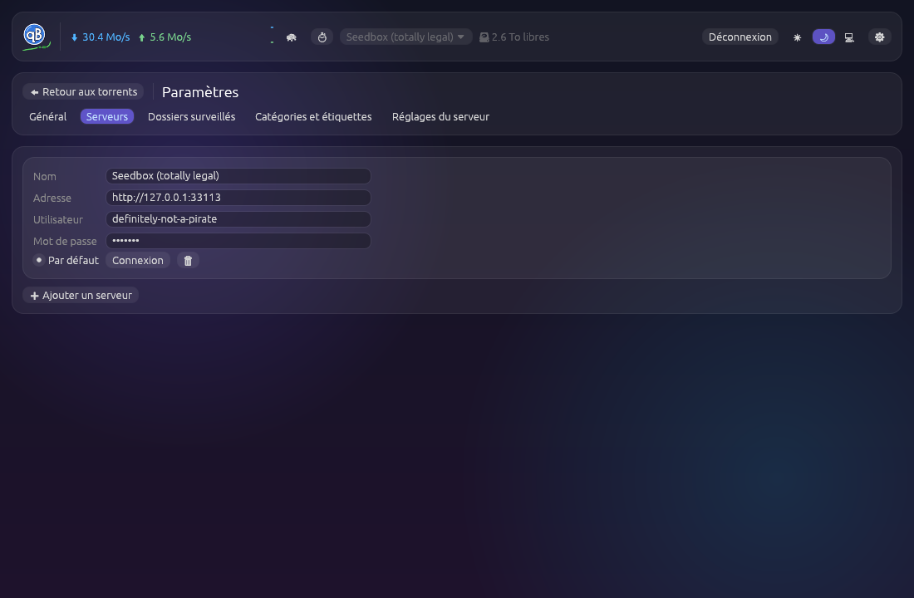
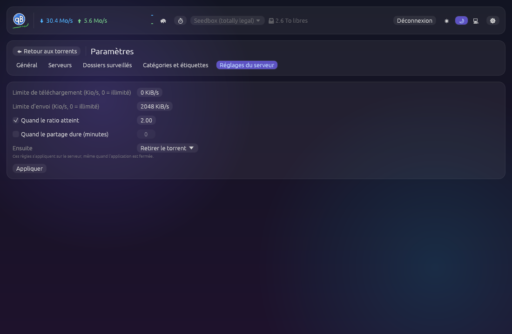

<div align="center">



# qBit-Distant-UI

**Une petite appli de bureau, jolie et simple, pour piloter un qBittorrent à distance (ou dans un Docker).**

[English](README.md) | **Français** | [日本語](README.ja.md)

[](LICENSE)

</div>

---

Chez moi, qBittorrent tourne dans un conteneur Docker derrière un VPN, et un autre vit sur une seedbox à l'autre bout du monde. La WebUI fait le travail, mais garder un onglet ouvert juste pour savoir si mes ISO Linux étaient finies, ça m'a vite saoulé. Alors j'ai écrit une vraie appli en Rust qui parle à l'API de la WebUI : une fenêtre pour tous les serveurs, un petit effet verre, thème sombre ou clair, sous Linux comme sous Windows.

> C'est un projet perso et **non officiel**, sans aucun lien avec le projet qBittorrent : l'appli discute simplement avec sa WebUI, comme le ferait ton navigateur. Tous les torrents des captures sont faux et servis par un faux serveur. Aucune ISO Linux n'a été maltraitée.


## Ce qu'elle fait

- **Plusieurs serveurs** : enregistre autant d'instances que tu veux (Docker local, seedbox, le NAS d'un pote...) et choisis celle qui se connecte toute seule au démarrage. Clique sur le nom du serveur dans la barre du haut pour voir les vitesses de tous les autres et basculer en un clic.
- **La liste de torrents qu'on attend** : progression, vitesses, ratio, temps restant, catégorie, filtres par état, par catégorie et par étiquette, tri, recherche.
- **Sélection multiple** : coche plusieurs torrents (Maj+clic pour une plage, Ctrl+A pour tout) puis mets-les en pause, relance, revérifie, déplace, change leur catégorie, ajoute une étiquette, change leur place dans la file ou supprime-les d'un coup.
- **Ajouter un torrent sans se fatiguer** : colle un lien magnet, choisis un `.torrent`, glisse-le dans la fenêtre, fais Ctrl+V n'importe où, ou clique simplement sur un lien magnet dans Firefox. Ça arrive dans l'appli, même si elle est déjà ouverte.
- **Explorateur de dossiers distant** : choisis où enregistrer sur le serveur en parcourant vraiment ses dossiers (qBittorrent 5.0 et plus).
- **Choisir ce qu'on télécharge** : décoche les fichiers dont tu ne veux pas, avant ou pendant le téléchargement.
- **Fenêtre de détails** : téléchargement séquentiel, premier et dernier morceau en priorité, démarrage forcé, renommage, catégorie, limites de vitesse par torrent, la liste des trackers, où l'on peut en ajouter ou en retirer, et les pairs connectés (adresse, client, pays, vitesses).
- **Catégories et étiquettes** : crée-les ou supprime-les, change le dossier par défaut d'une catégorie, colle des étiquettes sur tes torrents et filtre par étiquette.
- **File d'attente** : place un torrent tout en haut, monte-le, descends-le ou envoie-le tout en bas.
- **Les vitesses d'un coup d'œil** : un petit graphique des 3 dernières minutes et les limites globales (⏱) directement dans la barre du haut.
- **Raccourcis clavier** : Espace pour mettre en pause ou relancer la sélection, Entrée pour les détails, F5 pour actualiser, Ctrl+A, Suppr, Ctrl+F, Ctrl+O, Ctrl+V.
- **Dossiers surveillés** : dépose un `.torrent` dans un dossier local, il part vers le serveur avec la destination et la catégorie choisies, puis il est supprimé.
- **Ménage automatique** : quand un ratio ou une durée de partage est atteint, mets le torrent en pause, retire-le, ou retire-le avec ses fichiers. C'est le serveur qui applique ces règles, même appli fermée.
- **Zone de notification** : fermer la fenêtre laisse l'appli tourner dans la zone de notification, donc notifications, dossiers surveillés et liens Firefox continuent de marcher.
- **Notifications** de fin de téléchargement, avec l'espace disque libre et le mode tortue (limites alternatives) dans la barre du haut.
- **Les mots de passe ne traînent pas en clair** : ils sont rangés dans le trousseau du système (KWallet, GNOME Keyring, Gestionnaire d'identifiants Windows...).
- **Français, anglais et japonais**, au choix, à tout moment.

## Captures

### La liste des torrents



Tout d'un coup d'œil, avec les vitesses et l'espace libre en haut. Coche les cases à gauche pour faire apparaître la barre d'actions groupées :


### Ajouter un torrent



Choisis la destination, la catégorie et si ça démarre tout de suite. **Parcourir** ouvre les dossiers du serveur :



### Détails






### Paramètres







### Thème clair


## Installation

Il te faut un qBittorrent avec la WebUI activée (Outils -> Options -> Interface web), joignable depuis ta machine, et une version récente de Rust (`rustup`). Sous Linux, une zone de notification et un trousseau, c'est mieux, mais pas obligatoire.

```sh
git clone https://github.com/AnnoyedDev/qbit-distant-ui
cd qbit-distant-ui
cargo build --release
cp target/release/qbit-distant-ui ~/.local/bin/
```

Pour Windows, compile directement sous Windows avec le même `cargo build --release`, ou depuis Linux avec `rustup target add x86_64-pc-windows-gnu`, le paquet `mingw-w64-gcc`, puis `cargo build --release --target x86_64-pc-windows-gnu`. Le `.exe` se suffit à lui-même.

Au premier lancement, l'appli ouvre les paramètres **Serveurs** : indique l'adresse (par exemple `http://localhost:8080` ou `https://seedbox.example.com`), ton utilisateur et ton mot de passe de la WebUI, coche **Par défaut** et clique sur **Connexion**. Ensuite, dans **Général**, clique sur **Ouvrir les liens magnet et les .torrent avec cette application** pour que ton navigateur lui envoie les torrents.

### En ligne de commande

```
qbit-distant-ui                           ouvre l'appli
qbit-distant-ui "magnet:?xt=urn:btih:..."   ajoute un lien magnet
qbit-distant-ui ~/Téléchargements/x.torrent  ajoute un fichier .torrent
```

Si l'appli tourne déjà, le lien ou le fichier est transmis à la fenêtre ouverte au lieu de lancer une deuxième copie.

## Comment ça marche

C'est une appli Rust construite avec [egui](https://github.com/emilk/egui). Elle parle à qBittorrent via l'API v2 de la WebUI, en HTTP ou HTTPS, exactement comme l'interface web, et se rafraîchit toutes les deux secondes. Elle encaisse les petites bizarreries habituelles : réponses de connexion qui changent selon les versions, cookies mélangés à ceux de Cloudflare, serveurs qui ne demandent pas de mot de passe sur le réseau local. Un deuxième lancement passe ses arguments au premier via une socket locale : c'est comme ça que les liens du navigateur arrivent dans la fenêtre ouverte. La zone de notification utilise StatusNotifierItem sous Linux et la zone classique sous Windows.

## Désinstallation

```sh
rm ~/.local/bin/qbit-distant-ui
rm ~/.local/share/applications/qbit-distant-ui.desktop
rm ~/.local/share/icons/hicolor/256x256/apps/qbit-distant-ui.png
rm -r ~/.local/share/qbit-distant-ui
```

Les réglages sont dans `~/.local/share/qbit-distant-ui/` sous Linux et `%APPDATA%\qbit-distant-ui\data\` sous Windows ; les mots de passe sont dans le trousseau du système, sous le nom `qbit-distant-ui`. Si tu avais activé l'ouverture depuis le navigateur, retire aussi les deux lignes `qbit-distant-ui.desktop` de `~/.config/mimeapps.list` (Linux), ou les clés `magnet` et `qbitdistantui.torrent` dans `HKEY_CURRENT_USER\Software\Classes` (Windows).

## Envie d'aider ?

- **Traductions** : tous les textes sont dans un seul tableau, [src/i18n.rs](src/i18n.rs), une colonne par langue. Ajouter une langue, c'est ajouter une colonne.
- **Bugs et idées** : ouvre une issue en précisant ta version de qBittorrent et ce que tu t'attendais à voir.

Pas encore fait : la liste des pairs, le RSS et la recherche intégrée (qBittorrent les fait déjà très bien dans sa propre interface).

## Licence

[MIT](LICENSE) : sers-t'en, forke-la, modifie-la, vends-la, fais-en ce que tu veux. Garde juste la mention « Copyright (c) 2026 AnnoyedDev » quelque part dans ta copie.
