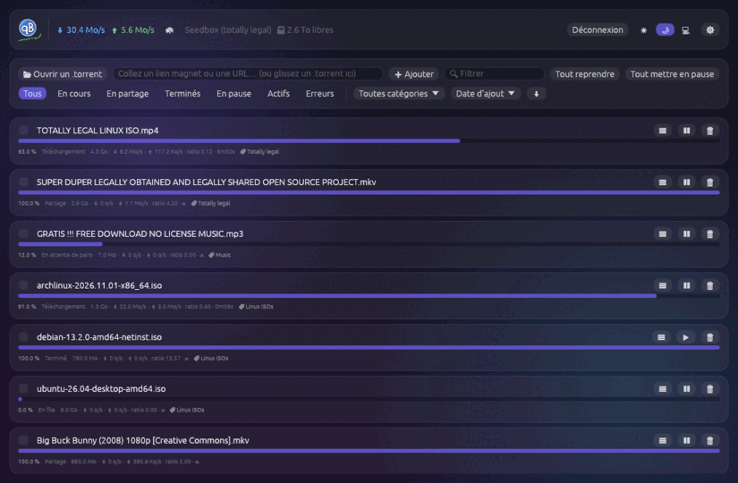
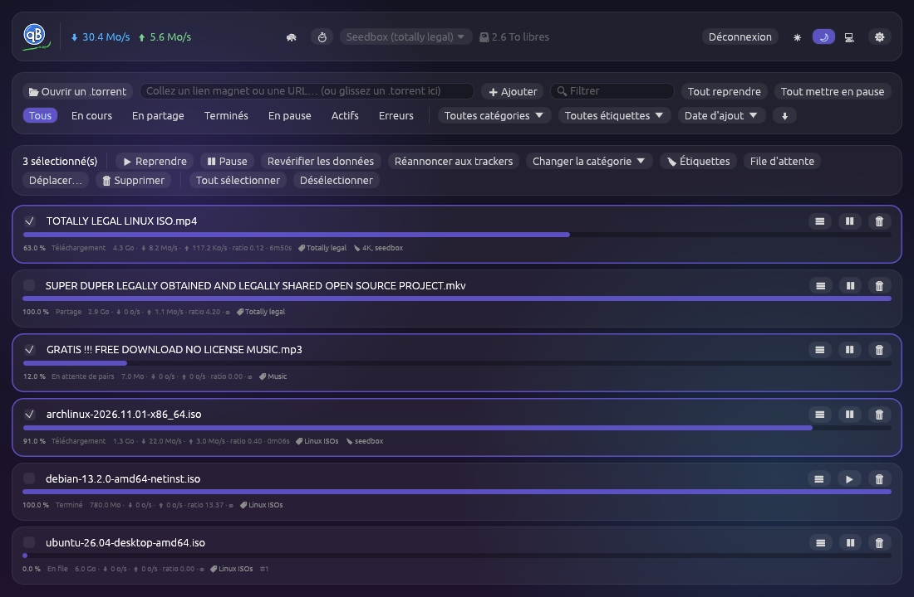
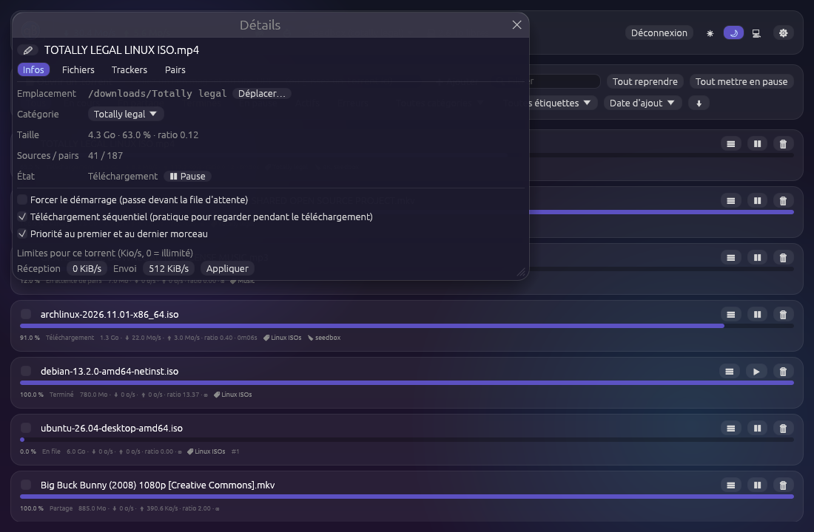
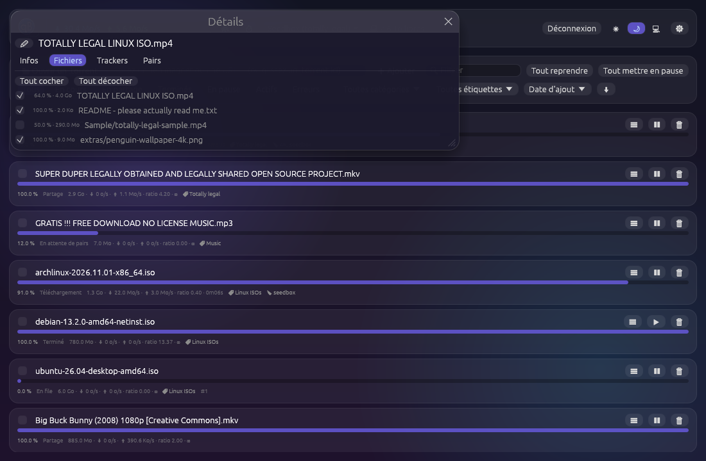
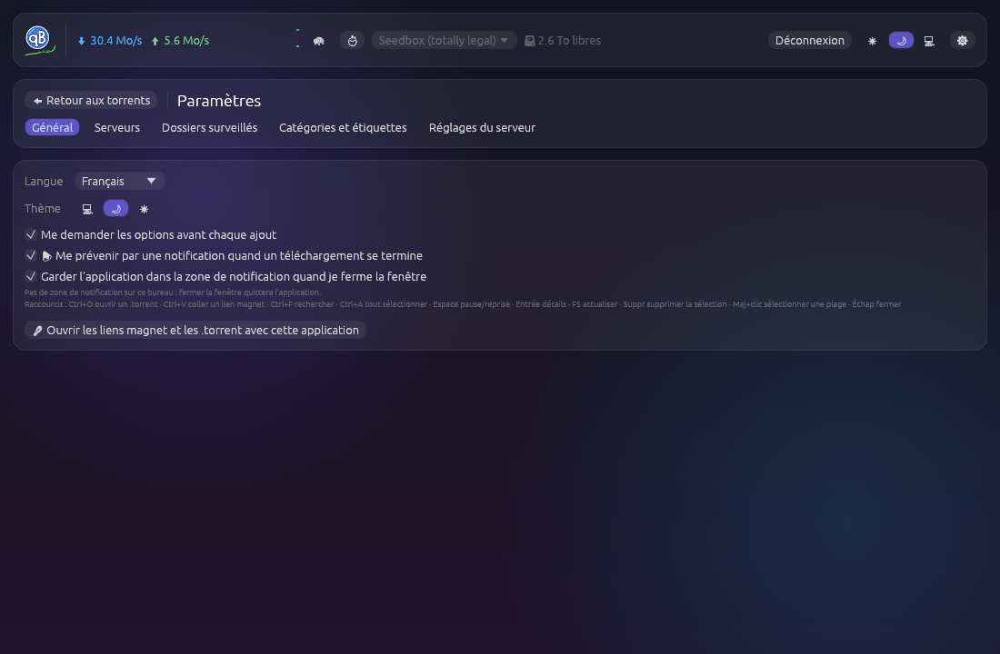
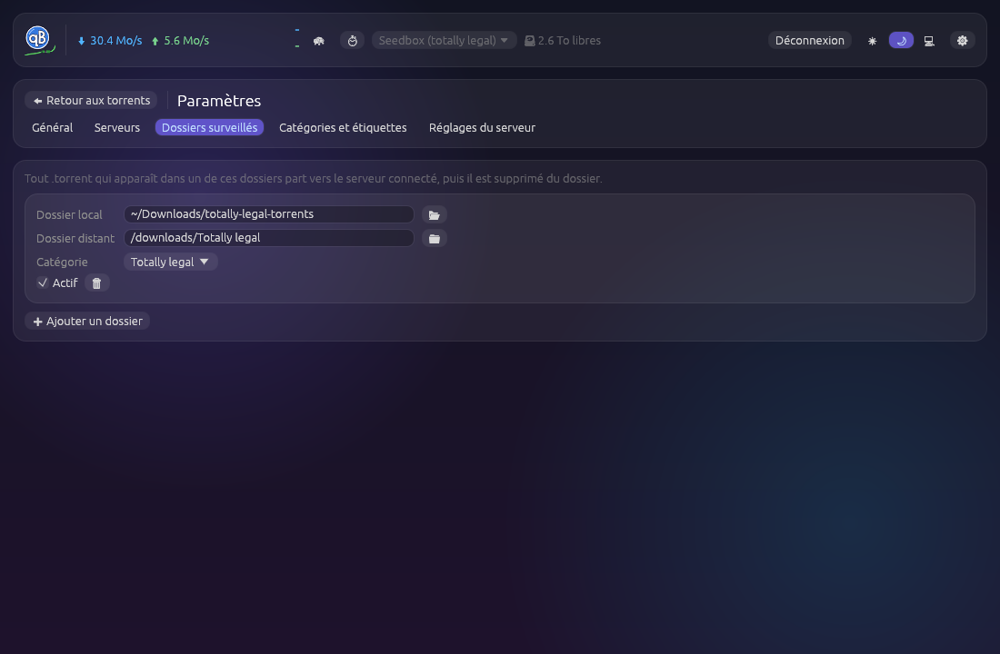
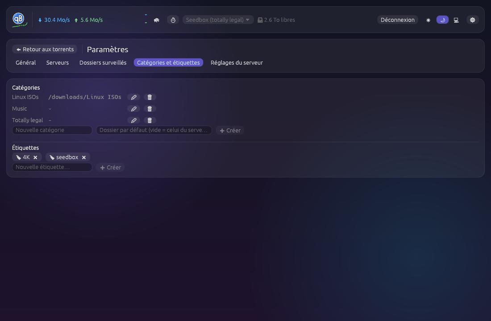
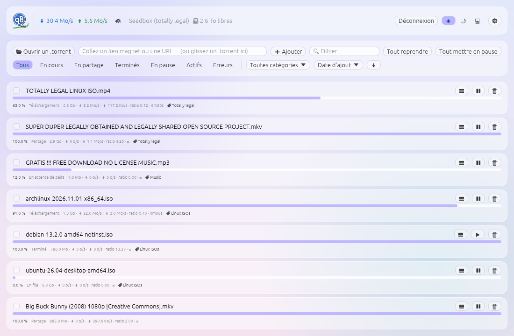

<div align="center">


# qBit-Distant-UI

Une appli de bureau pour piloter un qBittorrent qui tourne ailleurs : sur un serveur, une seedbox ou dans un Docker.

[English](README.md) | **Français** | [日本語](README.ja.md)

[](LICENSE)

</div>

J'ai un qBittorrent dans un conteneur Docker derrière un VPN, et un deuxième sur une seedbox. L'interface web fait le travail, mais laisser un onglet ouvert toute la journée pour savoir si mes ISO Linux étaient finies, ça m'a vite saoulé. J'ai donc écrit cette appli en Rust. Elle regroupe tous mes serveurs dans une seule fenêtre, tourne sous Linux et Windows, et propose un effet verre avec un thème sombre ou clair.

> Projet perso et non officiel, sans lien avec l'équipe de qBittorrent. L'appli passe par l'interface web de qBittorrent, comme ton navigateur. Les torrents des captures sont faux et viennent d'un serveur de test. Aucune ISO Linux n'a été maltraitée.



## Ce que tu peux faire avec

### Suivre tes torrents

La liste affiche la progression, les vitesses, le ratio, le temps restant et la catégorie. Tu peux filtrer par état, par catégorie ou par étiquette, trier et chercher.

La barre du haut montre un graphique des vitesses sur les 3 dernières minutes, l'espace disque libre, les limites de vitesse globales (⏱) et le mode tortue, qui active tes limites alternatives. Une notification te prévient quand un téléchargement est fini.

### Ajouter un torrent

Colle un lien magnet, choisis un fichier `.torrent`, glisse-le dans la fenêtre, fais Ctrl+V n'importe où ou clique sur un lien magnet dans Firefox. Le lien arrive dans l'appli même si elle est déjà ouverte.

Pour la destination, tu parcours directement les dossiers du serveur (qBittorrent 5.0 ou plus récent). Tu peux décocher les fichiers dont tu ne veux pas, avant ou pendant le téléchargement.

Tu peux aussi surveiller un dossier de ton ordinateur. Chaque `.torrent` déposé dedans part vers le serveur avec la destination et la catégorie choisies, puis le fichier est supprimé.

### Agir sur plusieurs torrents à la fois

Coche plusieurs torrents (Maj+clic pour une plage) pour les mettre en pause, les relancer, les revérifier, les déplacer, changer leur catégorie, leur ajouter une étiquette ou les supprimer d'un coup. Tu peux aussi les déplacer dans la file d'attente : tout en haut, plus haut, plus bas ou tout en bas.

### Régler un torrent en détail

La fenêtre de détails permet de renommer un torrent, de changer sa catégorie, de limiter sa vitesse, de forcer son démarrage, de télécharger dans l'ordre ou de commencer par le premier et le dernier morceau. Elle liste aussi ses fichiers, ses trackers (tu peux en ajouter et en retirer) et les pairs connectés avec leur adresse, leur client, leur pays et leurs vitesses.

### Ranger et faire le ménage

Les catégories et les étiquettes se créent et se suppriment dans les paramètres, où tu peux aussi changer le dossier par défaut d'une catégorie.

Les règles de ménage s'occupent des torrents qui ont atteint un ratio ou une durée de partage : mise en pause, retrait, ou retrait avec les fichiers. C'est le serveur qui les applique, donc elles marchent même quand l'appli est fermée.

### Gérer plusieurs serveurs

Enregistre autant de qBittorrent que tu veux (Docker local, seedbox, NAS d'un pote) et choisis celui qui se connecte au démarrage. Un clic sur le nom du serveur, dans la barre du haut, affiche les vitesses de tous les serveurs et te laisse passer de l'un à l'autre.

### Et aussi

- Fermer la fenêtre laisse l'appli dans la zone de notification. Les notifications, les dossiers surveillés et les liens Firefox continuent donc de marcher.
- Les mots de passe sont rangés dans le trousseau du système (KWallet, GNOME Keyring, Gestionnaire d'identifiants Windows) et pas dans un fichier en clair.
- L'interface existe en français, en anglais et en japonais, et tu changes de langue quand tu veux.

### Raccourcis clavier

- Espace : mettre en pause ou relancer la sélection
- Entrée : ouvrir les détails du torrent sélectionné
- F5 : actualiser
- Ctrl+A : tout sélectionner
- Échap : vider la sélection
- Suppr : supprimer la sélection
- Ctrl+F : chercher
- Ctrl+O : ouvrir un fichier `.torrent`
- Ctrl+V : ajouter le lien copié

## Captures

### La liste des torrents


Les vitesses et l'espace libre sont en haut. Coche les cases à gauche pour faire apparaître la barre d'actions groupées :



### Ajouter un torrent


Choisis la destination, la catégorie et si le torrent démarre tout de suite. **Parcourir** ouvre les dossiers du serveur :


### Détails






### Paramètres









### Thème clair



## Installation

Il te faut un qBittorrent dont l'interface web est activée (Outils -> Options -> Interface web) et que ton ordinateur peut joindre.

La dernière version se télécharge sur la [page des releases](https://github.com/AnnoyedDev/qbit-distant-ui/releases/latest).

Sous Windows, prends `qbit-distant-ui-windows-x86_64.exe` et lance-le. C'est un fichier unique, sans installeur.

Sous Linux, prends `qbit-distant-ui-linux-x86_64`, puis :

```sh
mkdir -p ~/.local/bin
chmod +x qbit-distant-ui-linux-x86_64
mv qbit-distant-ui-linux-x86_64 ~/.local/bin/qbit-distant-ui
```

Sous Linux, une zone de notification et un trousseau sont utiles, mais pas obligatoires.

### Premier lancement

L'appli ouvre les paramètres **Serveurs**. Indique l'adresse (par exemple `http://localhost:8080` ou `https://seedbox.example.com`), ton utilisateur et ton mot de passe de l'interface web, coche **Par défaut** et clique sur **Connexion**. Ensuite, dans **Général**, clique sur **Ouvrir les liens magnet et les .torrent avec cette application** pour que ton navigateur lui envoie les torrents.

### Compiler soi-même

Il faut une version récente de Rust (`rustup`).

```sh
git clone https://github.com/AnnoyedDev/qbit-distant-ui
cd qbit-distant-ui
cargo build --release
cp target/release/qbit-distant-ui ~/.local/bin/
```

Sous Windows, le même `cargo build --release` suffit. Pour compiler la version Windows depuis Linux, installe le paquet `mingw-w64-gcc`, lance `rustup target add x86_64-pc-windows-gnu`, puis `cargo build --release --target x86_64-pc-windows-gnu`.

### En ligne de commande

```
qbit-distant-ui                           ouvre l'appli
qbit-distant-ui "magnet:?xt=urn:btih:..."   ajoute un lien magnet
qbit-distant-ui ~/Téléchargements/x.torrent  ajoute un fichier .torrent
```

Si l'appli tourne déjà, le lien ou le fichier part vers la fenêtre ouverte et aucune deuxième copie ne se lance.

## Comment ça marche

L'appli est écrite en Rust avec [egui](https://github.com/emilk/egui). Elle utilise l'API v2 de l'interface web de qBittorrent, en HTTP ou HTTPS, comme le fait l'interface web elle-même, et se rafraîchit toutes les deux secondes. Elle gère les réponses de connexion qui changent selon les versions de qBittorrent, les cookies mélangés à ceux de Cloudflare et les serveurs qui ne demandent pas de mot de passe sur le réseau local. Un deuxième lancement passe ses arguments au premier par une socket locale, et c'est ainsi que les liens du navigateur arrivent dans la fenêtre ouverte. La zone de notification utilise StatusNotifierItem sous Linux et la zone classique sous Windows.

## Désinstallation

```sh
rm ~/.local/bin/qbit-distant-ui
rm ~/.local/share/applications/qbit-distant-ui.desktop
rm ~/.local/share/icons/hicolor/256x256/apps/qbit-distant-ui.png
rm -r ~/.local/share/qbit-distant-ui
```

Les réglages sont dans `~/.local/share/qbit-distant-ui/` sous Linux et `%APPDATA%\qbit-distant-ui\data\` sous Windows. Les mots de passe sont dans le trousseau du système, sous le nom `qbit-distant-ui`. Si tu avais activé l'ouverture depuis le navigateur, retire aussi les deux lignes `qbit-distant-ui.desktop` de `~/.config/mimeapps.list` (Linux), ou les clés `magnet` et `qbitdistantui.torrent` dans `HKEY_CURRENT_USER\Software\Classes` (Windows).

## Envie d'aider ?

Pour traduire l'appli, tout se passe dans [src/i18n.rs](src/i18n.rs). Les textes sont dans un seul tableau avec une colonne par langue, donc une nouvelle langue est une nouvelle colonne.

Pour un bug ou une idée, ouvre une issue en précisant ta version de qBittorrent et ce que tu t'attendais à voir.

Le RSS et la recherche intégrée ne sont pas encore faits. L'interface de qBittorrent s'en charge déjà très bien.

## Licence

[MIT](LICENSE). Sers-t'en, forke-la, modifie-la ou vends-la, du moment que tu gardes la mention « Copyright (c) 2026 AnnoyedDev » dans ta copie.
