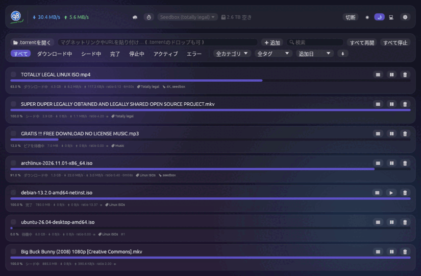
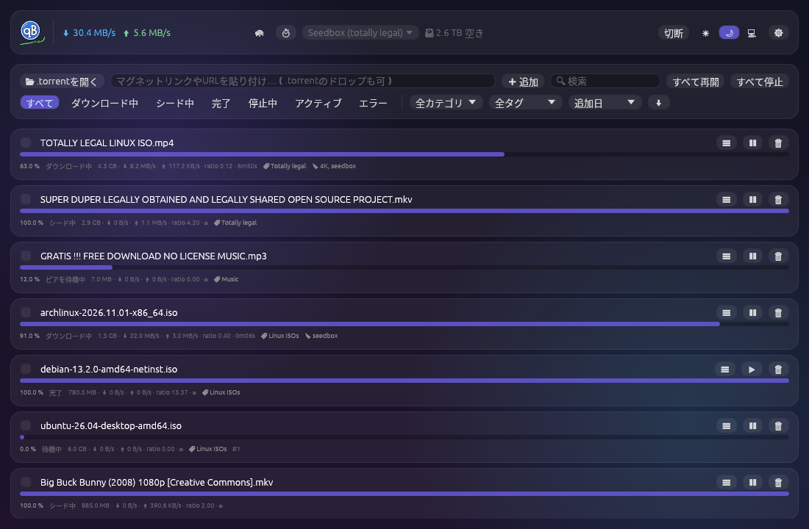
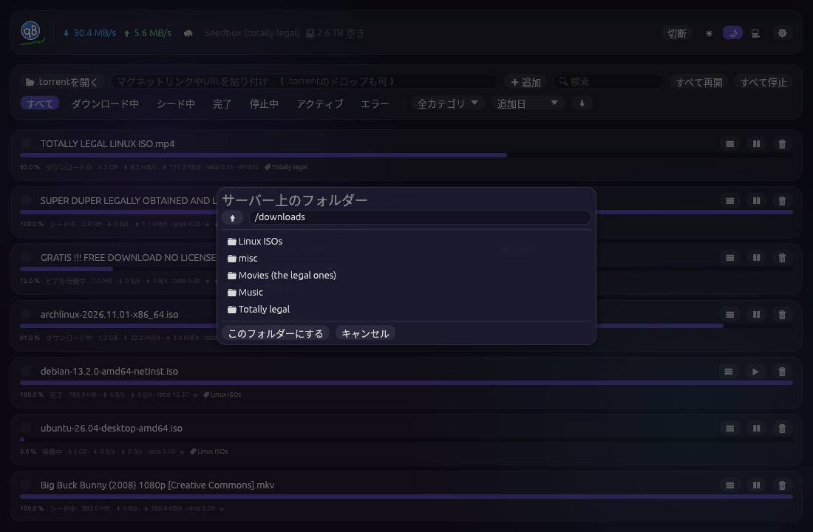
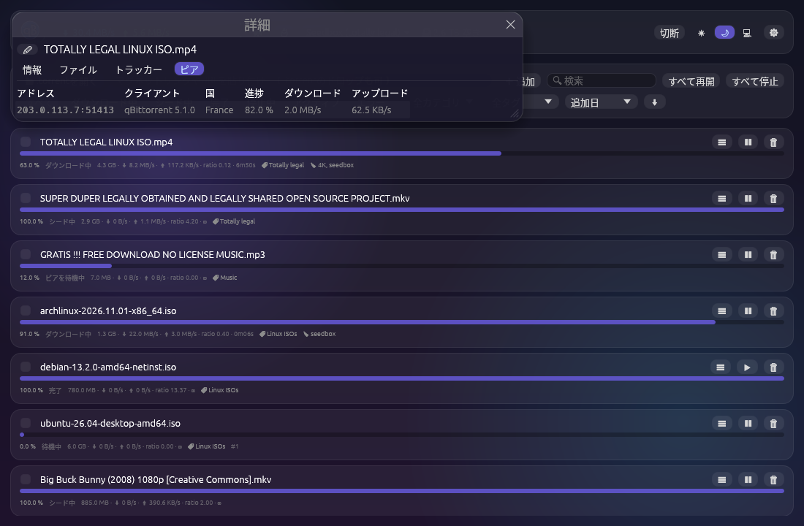
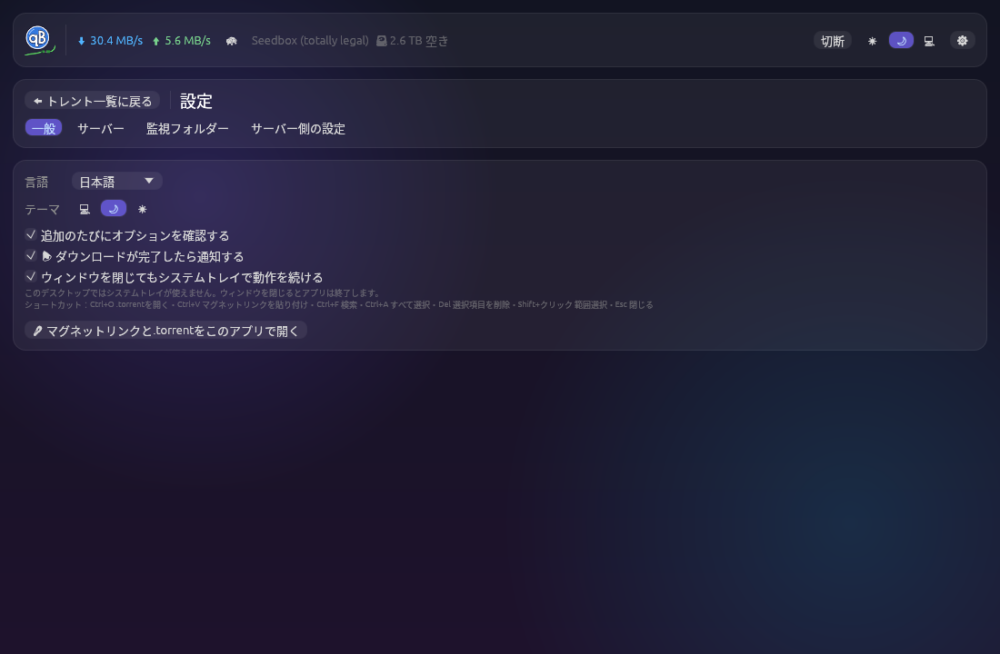
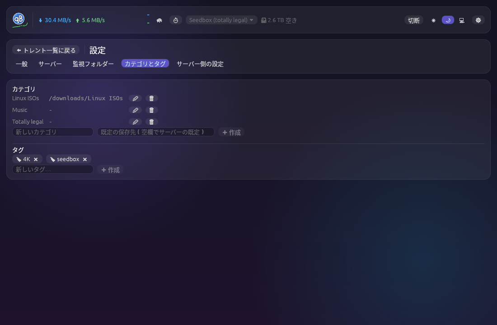

<div align="center">


# qBit-Distant-UI

別のマシンや Docker で動いている qBittorrent を、手元のパソコンから操作するデスクトップアプリです。

[English](README.md) | [Français](README.fr.md) | **日本語**

[](LICENSE)

</div>

qBittorrent を 2 つ使っています。ひとつは VPN の裏にある Docker コンテナ、もうひとつはシードボックスです。Web 画面でも操作はできますが、Linux の ISO が落ち終わったか確かめるためだけにブラウザのタブを開いたままにするのが面倒になり、Rust でこのアプリを書きました。すべてのサーバーをひとつのウィンドウで扱えます。Linux と Windows で動き、ガラス風の見た目にダークとライトのテーマがあります。

> 個人が作った非公式のアプリで、qBittorrent の開発チームとは関係ありません。ブラウザと同じように qBittorrent の WebUI と通信します。スクリーンショットのトレントはどれも架空で、テスト用サーバーのものです。Linux の ISO は一枚も傷ついていません。



## できること

| 項目 | 内容 |
| --- | --- |
| サーバー | ローカルの Docker、シードボックス、友だちの NAS など、何台でも登録できます。起動時に自動でつなぐ 1 台も選べます。上部バーのサーバー名を押すと全サーバーの現在の速度が並び、そこから切り替えられます。 |
| トレント一覧 | 進捗、速度、共有比、残り時間、カテゴリを表示します。状態、カテゴリ、タグでの絞り込みと、並べ替え、検索ができます。 |
| 追加 | マグネットリンクを貼る、`.torrent` を選ぶ、ウィンドウにドラッグ＆ドロップする、どこでも Ctrl+V を押す、Firefox でマグネットリンクをクリックする。どの方法でも追加できます。アプリが起動中でも、そのウィンドウに届きます。 |
| 保存先とファイル | サーバーのフォルダーをたどって保存先を選べます（qBittorrent 5.0 以降）。いらないファイルは、開始前でも途中でもチェックを外せます。 |
| まとめて操作 | 複数のトレントにチェックを入れると（Shift+クリックで範囲選択）、一時停止、再開、再チェック、移動、カテゴリ変更、タグ付け、削除を一度に行えます。 |
| キュー | トレントを先頭、ひとつ上、ひとつ下、末尾へ動かせます。 |
| 詳細ウィンドウ | 名前の変更、カテゴリ、トレントごとの速度制限、強制開始、順次ダウンロード、最初と最後のピースの優先を設定できます。ファイル、トラッカー（追加と削除も可能）、接続中のピア（アドレス、クライアント、国、速度）も確認できます。 |
| カテゴリとタグ | 作成と削除、カテゴリの既定フォルダーの変更ができます。 |
| 上部バー | 直近 3 分間の速度グラフ、空き容量、全体の速度制限（⏱）、代替速度制限に切り替えるタートルモードがあります。 |
| 監視フォルダー | パソコンのフォルダーに `.torrent` を置くと、指定した保存先とカテゴリでサーバーへ送り、その `.torrent` は削除します。 |
| 自動整理 | 共有比かシード時間が設定値に達したトレントを、停止、削除、ファイルごと削除のいずれかにします。サーバー側で動くので、アプリを閉じていても働きます。 |
| トレイと通知 | ウィンドウを閉じてもアプリはトレイに残ります。ダウンロード完了の通知、監視フォルダー、Firefox からのリンクはそのまま使えます。 |
| パスワード | システムのキーリング（KWallet、GNOME キーリング、Windows 資格情報マネージャー）に保存します。平文のファイルには書きません。 |
| 言語 | 日本語、英語、フランス語をいつでも切り替えられます。 |

### キーボードショートカット

- Space：選択したトレントを一時停止または再開
- Enter：選択したトレントの詳細を開く
- F5：更新
- Ctrl+A：すべて選択
- Esc：選択を解除
- Del：選択したトレントを削除
- Ctrl+F：検索
- Ctrl+O：`.torrent` ファイルを開く
- Ctrl+V：コピーしたリンクを追加

## スクリーンショット

### トレント一覧



上部に速度と空き容量が出ます。左のチェックボックスを入れると、まとめて操作するバーが現れます：


### トレントの追加


保存先、カテゴリ、すぐに開始するかどうかを選びます。**参照** を押すとサーバーのフォルダーが開きます：



### 詳細




### 設定







### ライトテーマ


## インストール

WebUI を有効にした qBittorrent（ツール -> オプション -> Web UI）に、お使いのパソコンから接続できる必要があります。

最新版は[リリースページ](https://github.com/AnnoyedDev/qbit-distant-ui/releases/latest)からダウンロードできます。

Windows では `qbit-distant-ui-windows-x86_64.exe` をそのまま実行します。インストーラーはなく、この 1 ファイルだけで動きます。

Linux では `qbit-distant-ui-linux-x86_64` をダウンロードし、次を実行します。

```sh
mkdir -p ~/.local/bin
chmod +x qbit-distant-ui-linux-x86_64
mv qbit-distant-ui-linux-x86_64 ~/.local/bin/qbit-distant-ui
```

Linux ではシステムトレイとキーリングがあると便利ですが、なくても動きます。

### 最初の設定

初めて起動すると **サーバー** 設定が開きます。アドレス（例：`http://localhost:8080` や `https://seedbox.example.com`）と WebUI のユーザー名、パスワードを入力し、**デフォルト** にチェックを入れて **接続** を押します。次に **一般** で **マグネットリンクと.torrentをこのアプリで開く** を押すと、ブラウザで開いたトレントがこのアプリに渡るようになります。

### ソースからビルドする

最近の Rust ツールチェーン（`rustup`）が必要です。

```sh
git clone https://github.com/AnnoyedDev/qbit-distant-ui
cd qbit-distant-ui
cargo build --release
cp target/release/qbit-distant-ui ~/.local/bin/
```

Windows でも同じ `cargo build --release` でビルドできます。Linux から Windows 版を作る場合は、`mingw-w64-gcc` パッケージを入れて `rustup target add x86_64-pc-windows-gnu` を実行し、`cargo build --release --target x86_64-pc-windows-gnu` でビルドします。

### コマンドライン

```
qbit-distant-ui                          アプリを開く
qbit-distant-ui "magnet:?xt=urn:btih:..."  マグネットリンクを追加
qbit-distant-ui ~/Downloads/file.torrent .torrent ファイルを追加
```

アプリがすでに起動している場合、リンクやファイルは開いているウィンドウに渡され、2 つ目は起動しません。

## しくみ

[egui](https://github.com/emilk/egui) を使った Rust 製のアプリです。ブラウザ版の画面と同じく、qBittorrent の WebUI API v2 を HTTP または HTTPS で呼び出し、2 秒ごとに表示を更新します。qBittorrent のバージョンで変わるログイン応答、Cloudflare のクッキーとの混在、ローカルネットワークではパスワードを求めないサーバーにも対応しています。2 回目に起動したプロセスは、ローカルソケットで引数を最初のプロセスに渡します。ブラウザのリンクが開いているウィンドウに届くのはこのためです。トレイは Linux では StatusNotifierItem、Windows では通常の通知領域を使います。

## アンインストール

```sh
rm ~/.local/bin/qbit-distant-ui
rm ~/.local/share/applications/qbit-distant-ui.desktop
rm ~/.local/share/icons/hicolor/256x256/apps/qbit-distant-ui.png
rm -r ~/.local/share/qbit-distant-ui
```

設定は Linux では `~/.local/share/qbit-distant-ui/`、Windows では `%APPDATA%\qbit-distant-ui\data\` にあります。パスワードはシステムのキーリングに `qbit-distant-ui` という名前で保存されています。ブラウザ連携を設定した場合は、`~/.config/mimeapps.list` にある `qbit-distant-ui.desktop` の 2 行（Linux）、または `HKEY_CURRENT_USER\Software\Classes` の `magnet` キーと `qbitdistantui.torrent` キー（Windows）も消してください。

## 手伝ってくれる方へ

翻訳は [src/i18n.rs](src/i18n.rs) で行います。文言はひとつの表にまとまっていて、言語ごとに 1 列あるので、新しい言語は列を 1 つ足せば追加できます。

バグ報告やアイデアは issue にお願いします。使っている qBittorrent のバージョンと、どうなってほしかったかを書いてください。

RSS と内蔵検索はまだありません。どちらも qBittorrent 本体の画面で十分に使えます。

## ライセンス

[MIT](LICENSE) です。使用、フォーク、改造、販売は自由です。コピーのどこかに「Copyright (c) 2026 AnnoyedDev」の表記を残してください。
