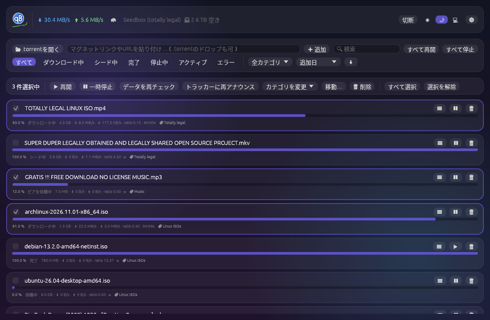
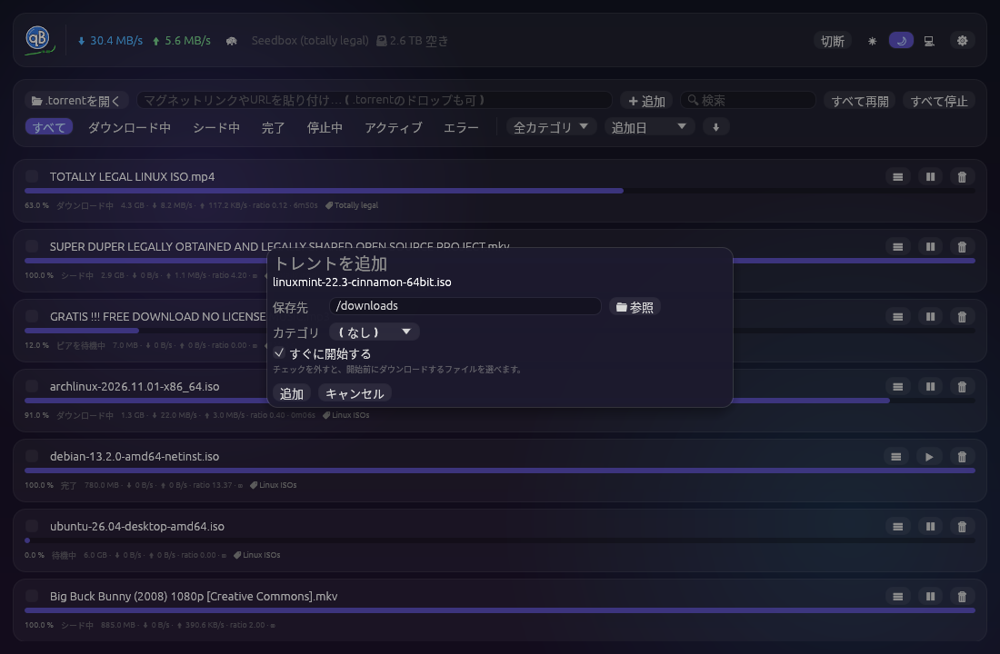
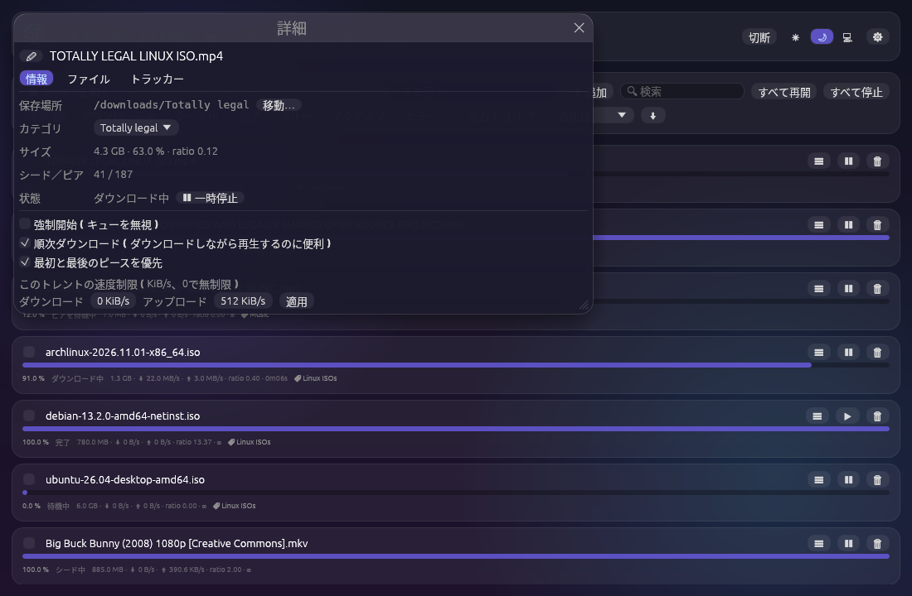
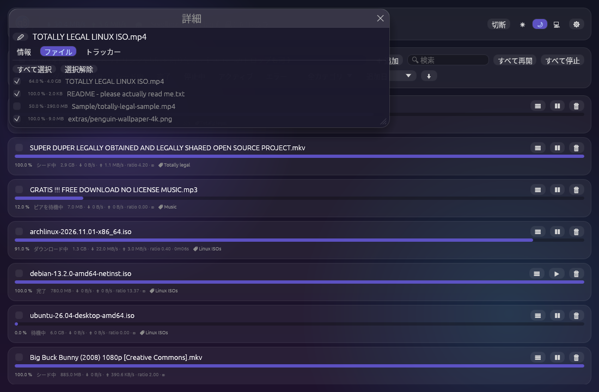
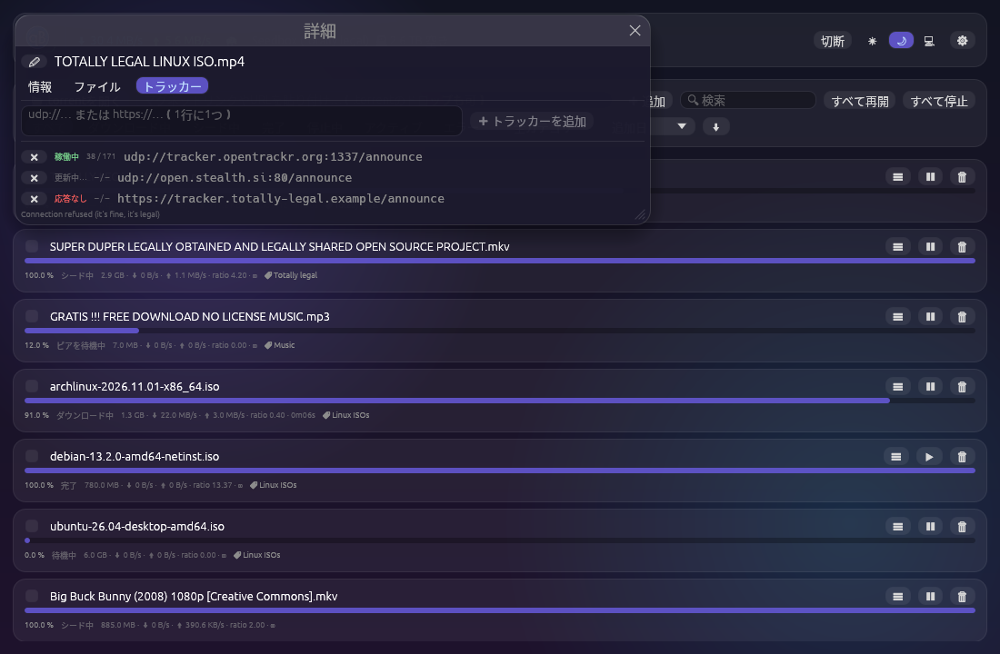
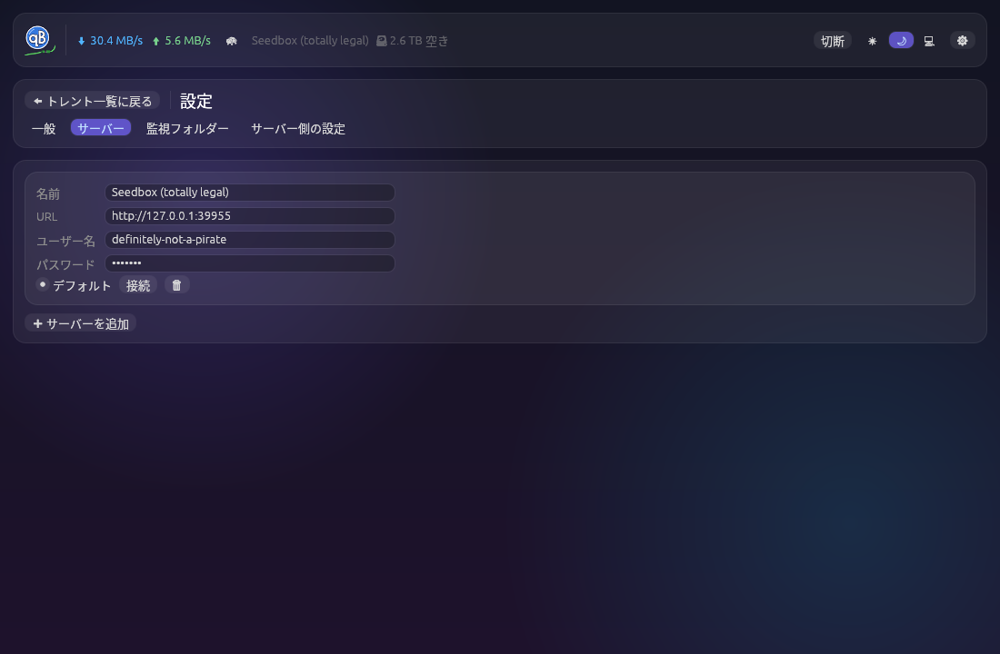
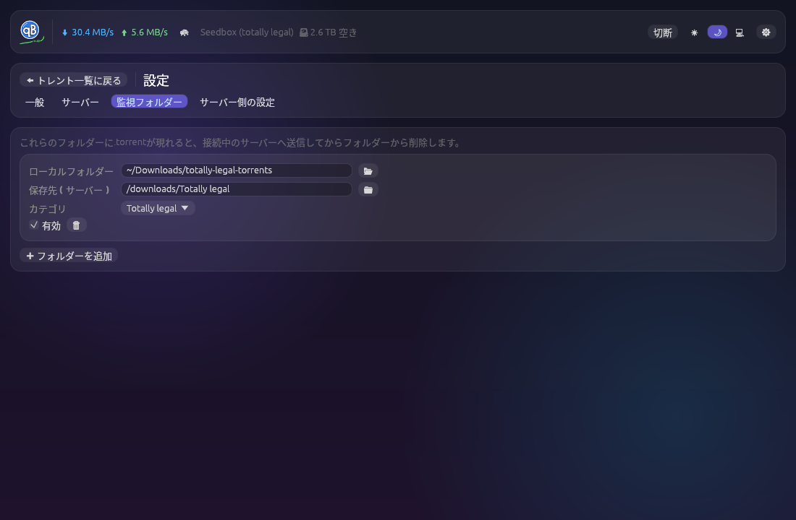
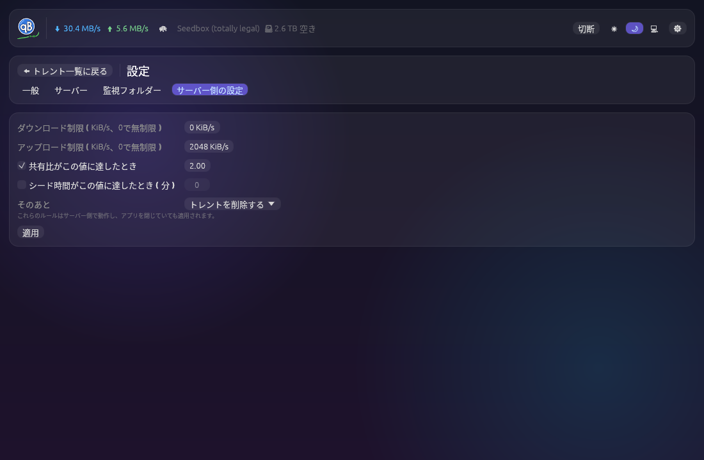
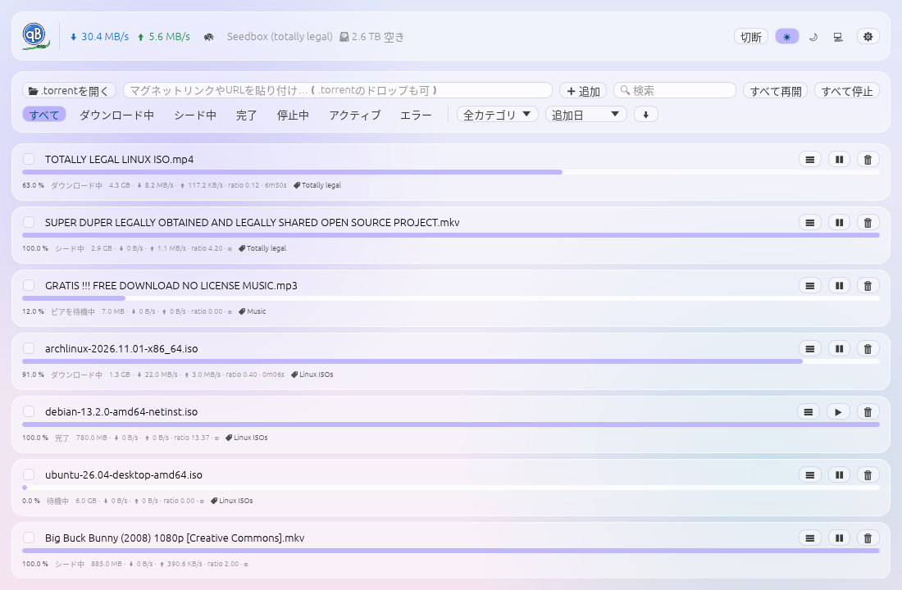

<div align="center">


# qBit-Distant-UI

**リモート（または Docker 上）の qBittorrent を操作する、小さくてきれいなデスクトップアプリ。**

[English](README.md) | [Français](README.fr.md) | **日本語**

[](LICENSE)

</div>

---

うちの qBittorrent は VPN の裏の Docker コンテナで動いていて、もう一台は遠くのシードボックスにあります。WebUI でも用は足りますが、Linux の ISO が落ち終わったか見るためだけにブラウザのタブを開きっぱなしにするのに疲れました。そこで WebUI の API と話すネイティブアプリを Rust で作りました。全部のサーバーをひとつのウィンドウで扱えて、ガラス風の見た目、ダーク／ライトテーマ、Linux と Windows に対応しています。

> 個人の**非公式**プロジェクトで、qBittorrent プロジェクトとは一切関係ありません。ブラウザと同じように WebUI と通信しているだけです。スクリーンショットのトレントはすべて架空のもので、ダミーサーバーから配信しています。Linux の ISO は一枚も傷ついていません。


## できること

- **複数サーバー**：ローカルの Docker、シードボックス、友だちの NAS など、好きなだけ登録できます。起動時に自動接続するサーバーも選べます。
- **ちゃんとしたトレント一覧**：進捗、速度、共有比、残り時間、カテゴリ。状態やカテゴリでの絞り込み、並べ替え、検索。
- **複数選択**：チェックを入れて（Shift+クリックで範囲選択、Ctrl+A ですべて）、一時停止・再開・再チェック・移動・カテゴリ変更・削除をまとめて実行できます。
- **追加は手軽に**：マグネットリンクの貼り付け、`.torrent` の選択やドラッグ＆ドロップ、どこでも Ctrl+V、あるいは Firefox でマグネットリンクをクリックするだけ。アプリがすでに開いていても、そのウィンドウに届きます。
- **サーバー上のフォルダーを参照**：保存先をサーバーのフォルダーを実際にたどって選べます（qBittorrent 5.0 以降）。
- **ダウンロードするファイルを選ぶ**：いらないファイルのチェックを、開始前でも途中でも外せます。
- **詳細ウィンドウ**：順次ダウンロード、最初と最後のピースを優先、強制開始、名前の変更、カテゴリ、トレントごとの速度制限、そしてトラッカー一覧（追加・削除も可能）。
- **監視フォルダー**：ローカルのフォルダーに `.torrent` を置くと、指定した保存先とカテゴリでサーバーへ送信し、ファイルは削除します。
- **自動お片付けルール**：共有比やシード時間が一定に達したら、停止、削除、またはファイルごと削除。ルールはサーバー側で動くので、アプリを閉じていても効きます。
- **システムトレイ**：ウィンドウを閉じてもトレイで動き続けるので、通知・監視フォルダー・Firefox からのリンクはそのまま使えます。
- ダウンロード完了の**通知**。上部バーには空き容量とタートルモード（代替速度制限）も。
- **パスワードを平文で保存しません**：システムのキーリング（KWallet、GNOME キーリング、Windows 資格情報マネージャーなど）に入ります。
- **日本語・英語・フランス語**にいつでも切り替えられます。

## スクリーンショット

### トレント一覧


上部に速度と空き容量、下に全トレントが並びます。左のチェックボックスを入れると、まとめて操作するバーが出てきます：



### トレントの追加



保存先、カテゴリ、すぐに開始するかを選びます。**参照** でサーバーのフォルダーを開けます：


### 詳細







### 設定








### ライトテーマ



## インストール

WebUI を有効にした qBittorrent（ツール -> オプション -> Web UI）にこのマシンから接続できること、そして最近の Rust ツールチェーン（`rustup`）が必要です。Linux ではシステムトレイとキーリングがあると便利ですが、なくても動きます。

```sh
git clone https://github.com/AnnoyedDev/qbit-distant-ui
cd qbit-distant-ui
cargo build --release
cp target/release/qbit-distant-ui ~/.local/bin/
```

Windows 版は Windows 上で同じく `cargo build --release` するか、Linux から `rustup target add x86_64-pc-windows-gnu` と `mingw-w64-gcc` パッケージを入れて `cargo build --release --target x86_64-pc-windows-gnu` でクロスコンパイルできます。`.exe` は単体で動きます。

初回起動時は **サーバー** 設定が開きます。アドレス（例：`http://localhost:8080` や `https://seedbox.example.com`）と WebUI のユーザー名・パスワードを入れ、**デフォルト** にチェックして **接続** を押してください。続いて **一般** の **マグネットリンクと.torrentをこのアプリで開く** を押すと、ブラウザからトレントが渡されるようになります。

### コマンドライン

```
qbit-distant-ui                          アプリを開く
qbit-distant-ui "magnet:?xt=urn:btih:..."  マグネットリンクを追加
qbit-distant-ui ~/Downloads/file.torrent .torrent ファイルを追加
```

アプリがすでに起動していれば、2つ目を立ち上げずに、開いているウィンドウへリンクやファイルを渡します。

## しくみ

[egui](https://github.com/emilk/egui) を使った Rust 製アプリです。ブラウザ版の UI と同じく、WebUI API v2 を HTTP／HTTPS で叩き、2 秒ごとに更新します。バージョンごとに違うログイン応答、Cloudflare のクッキーとの混在、ローカルネットワークでは認証を省くサーバーなど、よくある癖にも対応しています。2 回目の起動はローカルソケット経由で引数を最初のプロセスに渡すので、ブラウザのリンクも開いているウィンドウに届きます。トレイは Linux では StatusNotifierItem、Windows では通常の通知領域を使います。

## アンインストール

```sh
rm ~/.local/bin/qbit-distant-ui
rm ~/.local/share/applications/qbit-distant-ui.desktop
rm ~/.local/share/icons/hicolor/256x256/apps/qbit-distant-ui.png
rm -r ~/.local/share/qbit-distant-ui
```

設定は Linux では `~/.local/share/qbit-distant-ui/`、Windows では `%APPDATA%\qbit-distant-ui\data\` にあります。パスワードはシステムのキーリングに `qbit-distant-ui` という名前で保存されています。ブラウザ連携を設定した場合は、`~/.config/mimeapps.list` の `qbit-distant-ui.desktop` の 2 行（Linux）、または `HKEY_CURRENT_USER\Software\Classes` の `magnet` と `qbitdistantui.torrent` キー（Windows）も消してください。

## 手伝ってくれる方へ

- **翻訳**：文言はすべて [src/i18n.rs](src/i18n.rs) のひとつの表にまとまっていて、言語ごとに1列です。言語を増やすなら列を1つ足すだけです。
- **バグ報告・アイデア**：issue を立てて、使っている qBittorrent のバージョンと、本来どうなってほしかったかを書いてください。

未対応：ピア一覧、RSS、内蔵検索（このあたりは qBittorrent 本体の UI がすでによくできています）。

## ライセンス

[MIT](LICENSE)：使うのも、フォークするのも、改造するのも、売るのも自由です。コピーのどこかに「Copyright (c) 2026 AnnoyedDev」の表記だけ残しておいてください。
