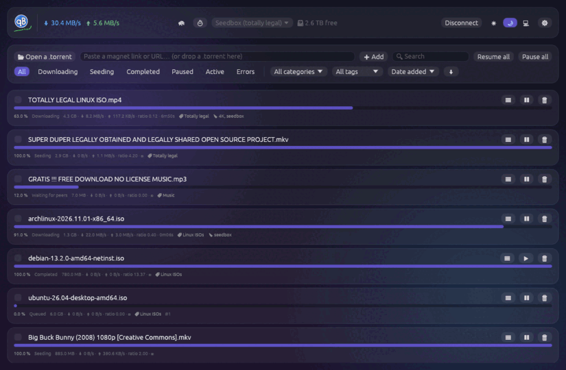
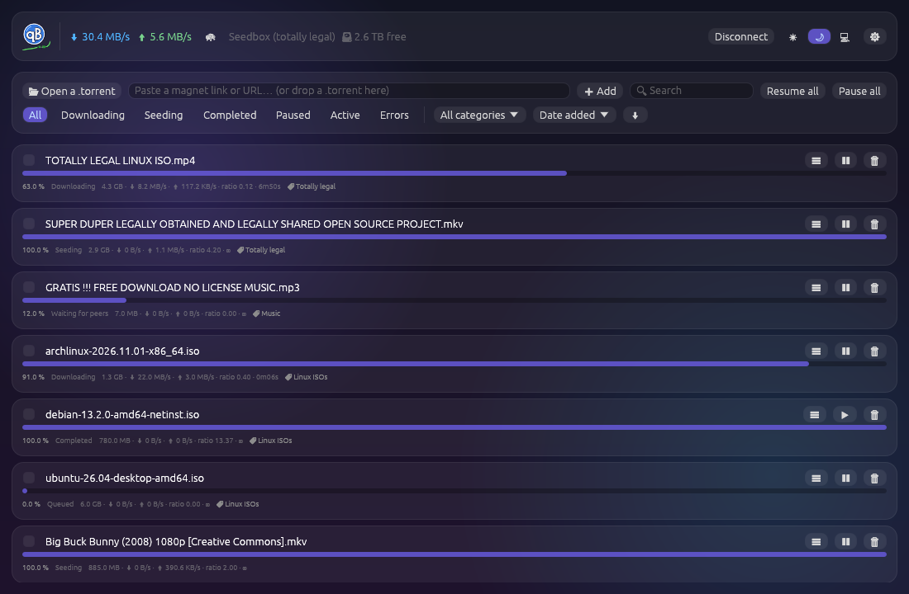
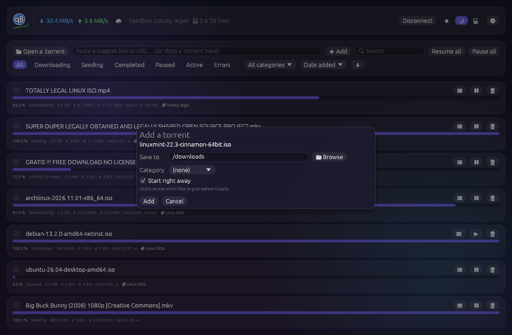
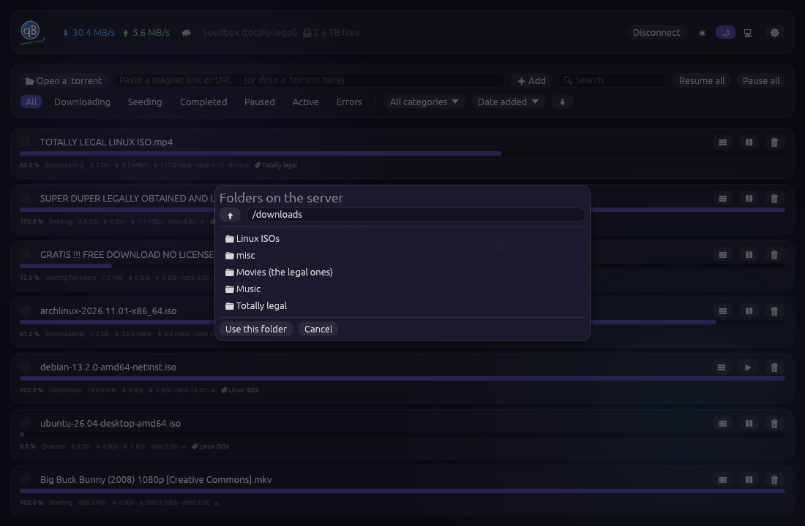
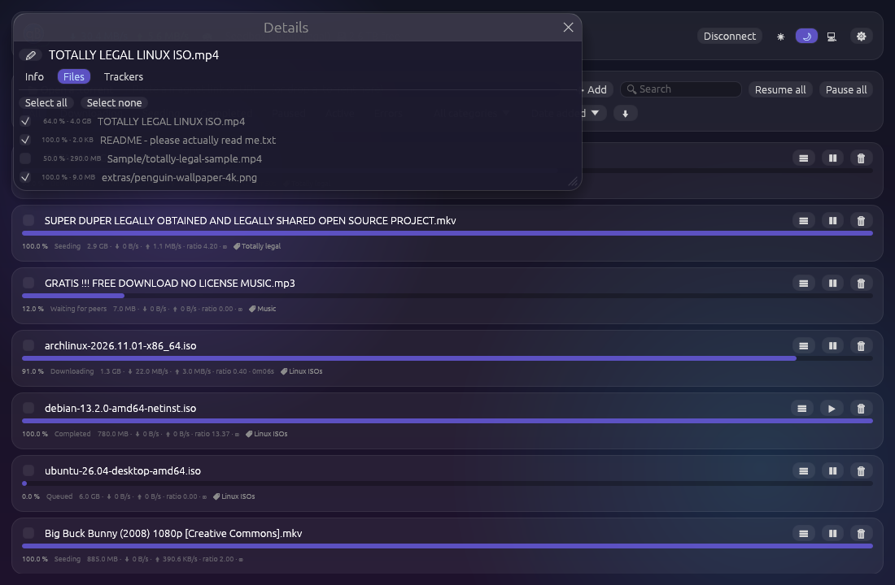
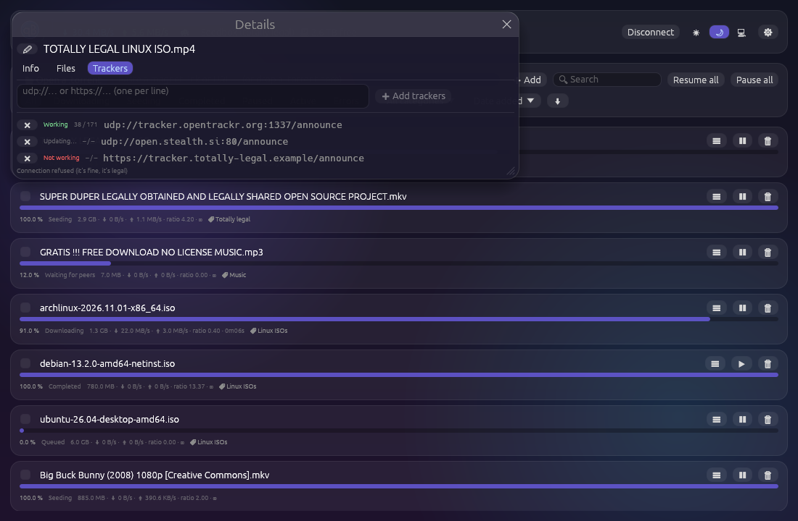
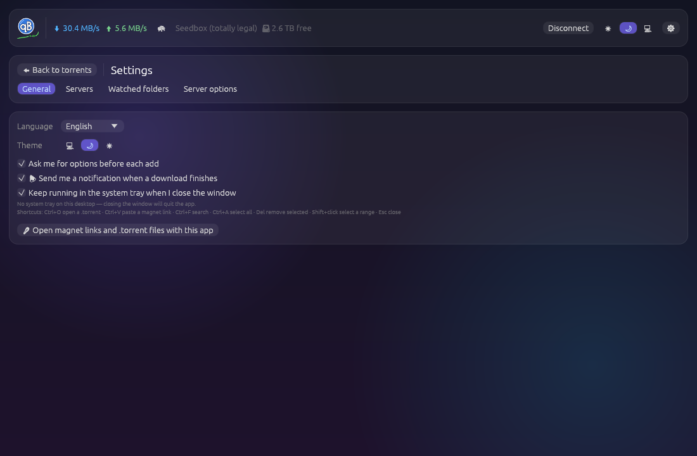
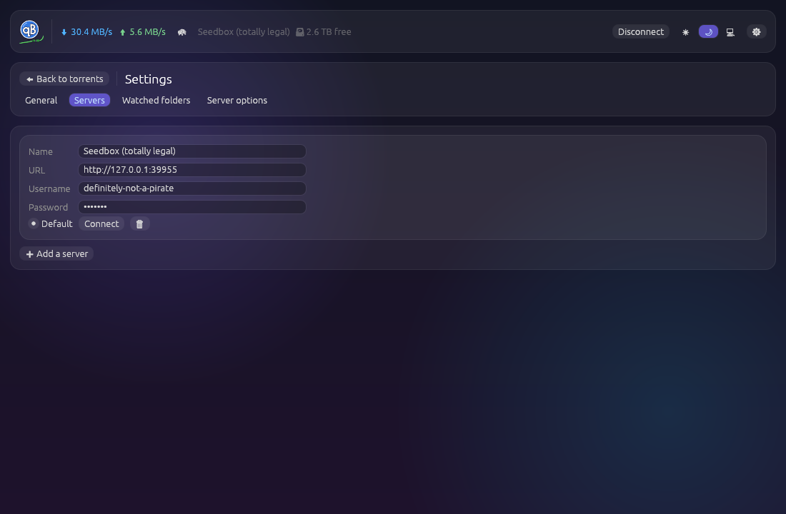
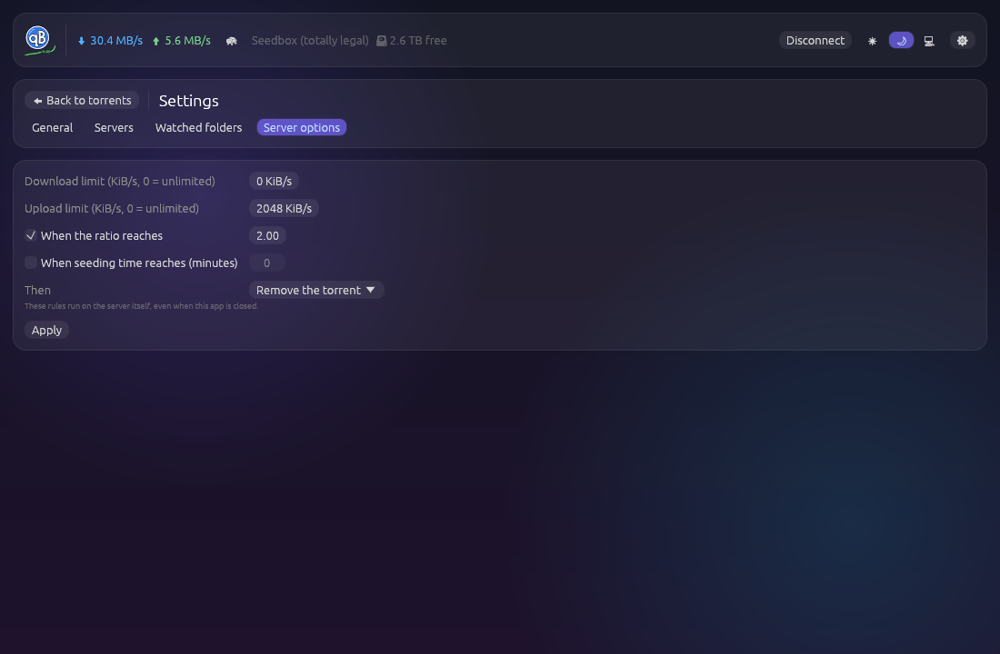
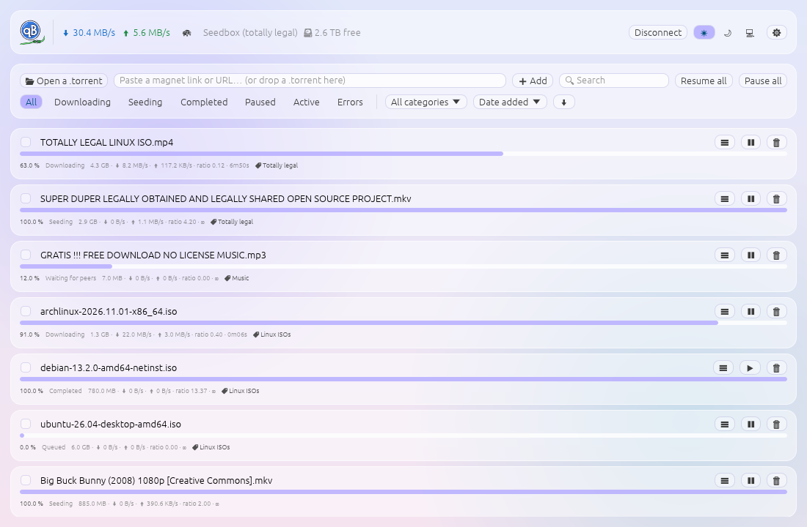

<div align="center">


# qBit-Distant-UI

**A small, good-looking desktop app to drive a remote (or Dockerized) qBittorrent.**

**English** | [Français](README.fr.md) | [日本語](README.ja.md)

[](LICENSE)

</div>

---

My qBittorrent lives in a Docker container behind a VPN, and another one runs on a seedbox far away. The WebUI works, but I was tired of keeping a browser tab open just to check whether my Linux ISOs were done. So I wrote a native app in Rust that talks to the WebUI API: one window, every server, glassy look, dark and light themes, Linux and Windows.

> This is a personal, **unofficial** project. It has no connection to the qBittorrent project, it just talks to its WebUI like your browser does. Every torrent in the screenshots is fake and served by a mock server; no Linux ISO was harmed.



## What it does

- **Several servers**: save as many qBittorrent instances as you want (local Docker, seedbox, your friend's NAS...) and pick one to connect to automatically at startup.
- **The torrent list you'd expect**: progress, speeds, ratio, ETA, category, filters by status and category, sorting, search.
- **Multi-select**: tick a few torrents (Shift+click for a range, Ctrl+A for everything) and pause, resume, recheck, move, recategorize or delete them in one go.
- **Adding torrents, the lazy way**: paste a magnet link, pick a `.torrent` file, drag and drop it, press Ctrl+V anywhere, or just click a magnet link in Firefox. It ends up in the app even if it's already open.
- **Remote folder browser**: choose where things are saved on the server by actually browsing its folders (qBittorrent 5.0+).
- **Pick what you download**: untick the files you don't want before or after the download starts.
- **Details window**: sequential download, first and last pieces first, force start, rename, category, per-torrent speed limits, and the tracker list, where you can add or remove trackers.
- **Watched folders**: drop a `.torrent` in a local folder, it gets sent to the server with the folder and category you chose, then deleted.
- **Auto-cleanup rules**: when a ratio or a seeding time is reached, pause the torrent, remove it, or remove it along with its files. The server applies these rules even when the app is closed.
- **System tray**: closing the window keeps the app running in the tray, so notifications, watched folders and Firefox links keep working.
- **Notifications** when a download finishes, plus free disk space and the turtle mode (alternative speed limits) in the top bar.
- **Passwords stay out of plain text**: they go to the system keyring (KWallet, GNOME Keyring, Windows Credential Manager...).
- **English, French and Japanese**, switchable at any time.

## Screenshots

### Torrent list



Everything at a glance, with the speeds and free space up top. Tick the boxes on the left to bring up the bulk actions bar:


### Adding a torrent



Choose the destination, the category and whether it starts right away. **Browse** opens the server's folders:



### Details






### Settings








### Light theme



## Install

You need a qBittorrent with the WebUI turned on (Tools -> Options -> Web UI), reachable from your machine, and a recent Rust toolchain (`rustup`). On Linux, a desktop with a system tray and a keyring is nice to have but not required.

```sh
git clone https://github.com/AnnoyedDev/qbit-distant-ui
cd qbit-distant-ui
cargo build --release
cp target/release/qbit-distant-ui ~/.local/bin/
```

For Windows, build it on Windows with the same `cargo build --release`, or cross-compile from Linux with `rustup target add x86_64-pc-windows-gnu` and the `mingw-w64-gcc` package, then `cargo build --release --target x86_64-pc-windows-gnu`. The `.exe` is self-contained.

On first launch, the app opens the **Servers** settings: fill in the address (for example `http://localhost:8080` or `https://seedbox.example.com`), your WebUI username and password, tick **Default** and hit **Connect**. Then, in **General**, click **Open magnet links and .torrent files with this app** so your browser hands torrents over.

### Command line

```
qbit-distant-ui                          open the app
qbit-distant-ui "magnet:?xt=urn:btih:..."  add a magnet link
qbit-distant-ui ~/Downloads/file.torrent add a .torrent file
```

If the app is already running, the link or file is handed to the open window instead of starting a second copy.

## How it works

It's a Rust app built on [egui](https://github.com/emilk/egui). It talks to qBittorrent through its WebUI API v2 over HTTP or HTTPS, the same way the browser interface does, and refreshes every two seconds. It copes with the usual quirks: the different login answers between versions, cookies mixed with Cloudflare's, servers that skip authentication for local networks. A second launch hands its arguments to the first one over a local socket, which is how browser links reach the open window. The tray uses StatusNotifierItem on Linux and the regular tray on Windows.

## Uninstall

```sh
rm ~/.local/bin/qbit-distant-ui
rm ~/.local/share/applications/qbit-distant-ui.desktop
rm ~/.local/share/icons/hicolor/256x256/apps/qbit-distant-ui.png
rm -r ~/.local/share/qbit-distant-ui
```

Settings live in `~/.local/share/qbit-distant-ui/` on Linux and `%APPDATA%\qbit-distant-ui\data\` on Windows; passwords are in your system keyring under `qbit-distant-ui`. If you set up the browser links, also remove the two `qbit-distant-ui.desktop` lines from `~/.config/mimeapps.list` (Linux), or the `magnet` and `qbitdistantui.torrent` keys under `HKEY_CURRENT_USER\Software\Classes` (Windows).

## Want to help?

- **Translations**: every string lives in a single table in [src/i18n.rs](src/i18n.rs), one column per language. Adding a language means adding a column.
- **Bugs and ideas**: open an issue, say which qBittorrent version you use and what you expected to happen.

Not done yet: the peer list, RSS, and built-in search (qBittorrent already does those well in its own UI).

## License

[MIT](LICENSE): use it, fork it, change it, sell it, whatever you like. Just keep the "Copyright (c) 2026 AnnoyedDev" notice somewhere in your copy.
