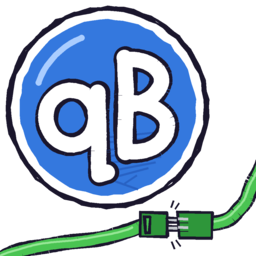
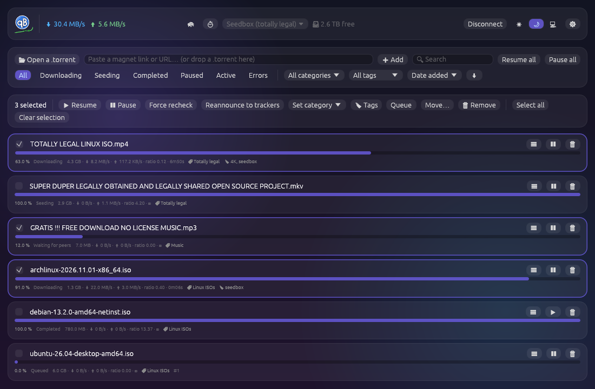
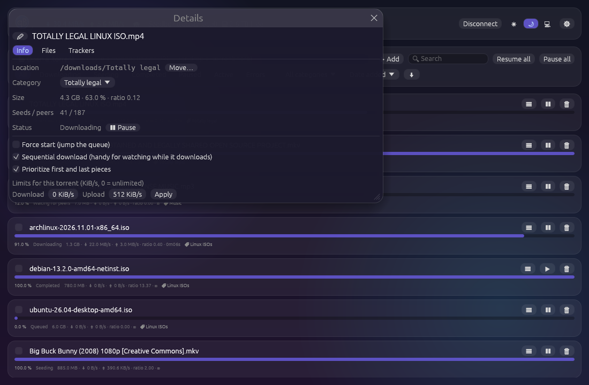
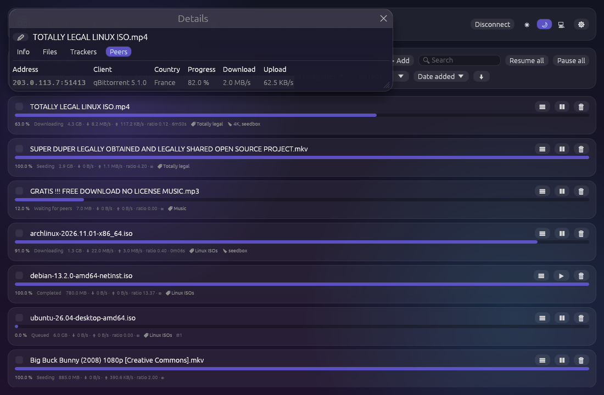
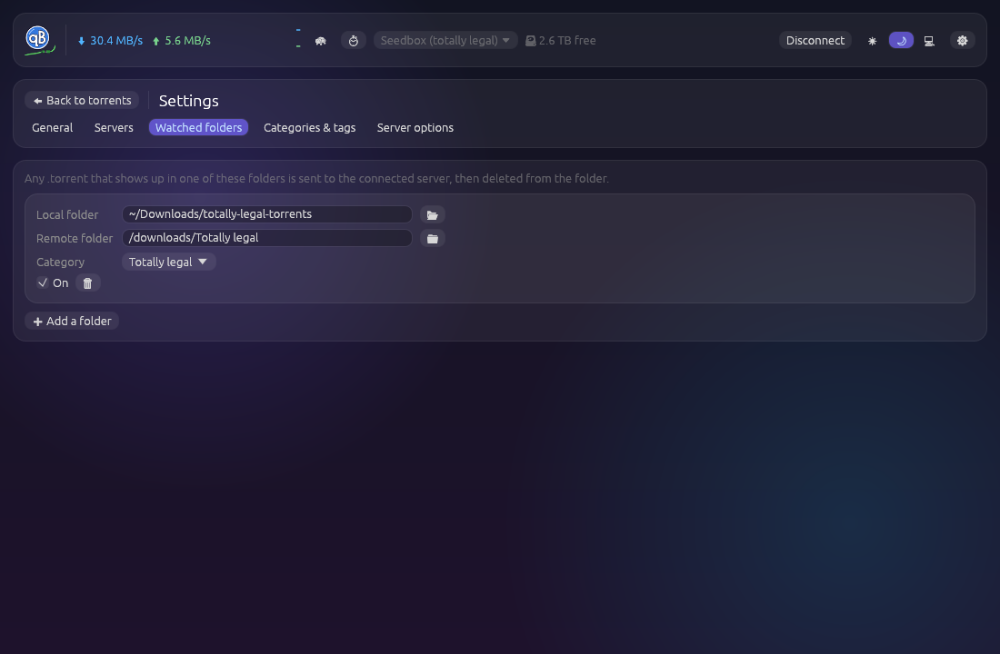
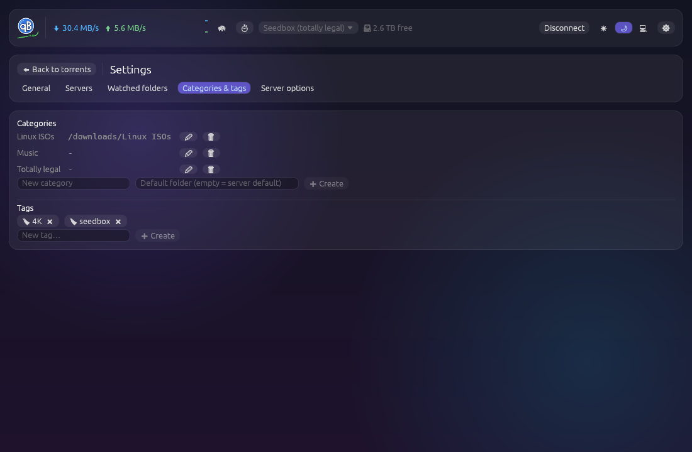

<div align="center">



# qBit-Distant-UI

A desktop app to control a qBittorrent that runs on another machine or in Docker.

**English** | [Français](README.fr.md) | [日本語](README.ja.md)

[](LICENSE)

</div>

My qBittorrent runs in a Docker container behind a VPN, and a second one sits on a seedbox. The web interface works, but I got tired of keeping a browser tab open to check whether my Linux ISOs were done. So I wrote this app in Rust. It shows all my servers in one window, runs on Linux and Windows, and has a glass-style look with a dark and a light theme.

> This is a personal, unofficial project with no link to the qBittorrent team. The app talks to qBittorrent's web interface the same way your browser does. The torrents in the screenshots are fake and come from a mock server; no Linux ISO was harmed.


## What you can do with it

- Save as many servers as you like (local Docker, seedbox, a friend's NAS) and pick one to connect to at startup. Click the server name in the top bar to see the live speeds of all of them and switch.
- See your torrents with their progress, speeds, ratio, time left and category. You can filter by status, category or tag, sort and search.
- Add a torrent by pasting a magnet link, picking a `.torrent` file, dropping it on the window, pressing Ctrl+V anywhere, or clicking a magnet link in Firefox. The link reaches the app even if it is already open.
- Choose the save folder by browsing the server's own folders (qBittorrent 5.0 or newer), and untick the files you don't want before or during the download.
- Tick several torrents (Shift+click selects a range) to pause, resume, recheck, move, recategorize, tag or delete them in one go.
- Move torrents in the queue: to the top, up, down or to the bottom.
- Open a torrent's details to rename it, change its category, limit its speed, force it to start, download it sequentially or fetch the first and last pieces first. The same window lists its files, its trackers (you can add and remove them) and the connected peers with their address, client, country and speeds.
- Create and delete categories and tags, and change a category's default folder.
- Read the top bar: a graph of the last 3 minutes of speed, the free disk space, the global speed limits (⏱) and turtle mode, which switches to your alternative speed limits.
- Watch a local folder. Any `.torrent` you drop in it is sent to the server with the save folder and category you chose, and the `.torrent` file is then deleted.
- Set cleanup rules. Once a torrent reaches a ratio or a seeding time, it is paused, removed, or removed with its files. The server applies these rules, so they work while the app is closed.
- Close the window and the app stays in the system tray, so download notifications, watched folders and Firefox links keep working.
- Passwords are stored in the system keyring (KWallet, GNOME Keyring, Windows Credential Manager) instead of a plain text file.
- The interface is in English, French and Japanese, and you can switch at any time.

### Keyboard shortcuts

| Key | Action |
| --- | --- |
| Space | Pause or resume the selection |
| Enter | Open the details of the selected torrent |
| F5 | Refresh |
| Ctrl+A | Select everything |
| Esc | Clear the selection |
| Del | Delete the selection |
| Ctrl+F | Search |
| Ctrl+O | Open a `.torrent` file |
| Ctrl+V | Add the link you copied |

## Screenshots

### Torrent list


Speeds and free space are at the top. Tick the boxes on the left to show the bulk actions bar:



### Adding a torrent


Choose the destination, the category and whether the torrent starts right away. **Browse** opens the server's folders:


### Details






### Settings







### Light theme


## Install

You need a qBittorrent with the Web UI turned on (Tools -> Options -> Web UI) that your computer can reach.

Download the latest version from the [releases page](https://github.com/AnnoyedDev/qbit-distant-ui/releases/latest).

On Windows, get `qbit-distant-ui-windows-x86_64.exe` and run it. It is a single self-contained file with no installer.

On Linux, get `qbit-distant-ui-linux-x86_64`, then:

```sh
mkdir -p ~/.local/bin
chmod +x qbit-distant-ui-linux-x86_64
mv qbit-distant-ui-linux-x86_64 ~/.local/bin/qbit-distant-ui
```

A system tray and a keyring are nice to have on Linux but not required.

### First launch

The app opens the **Servers** settings. Enter the address (for example `http://localhost:8080` or `https://seedbox.example.com`) and your Web UI username and password, tick **Default** and click **Connect**. Then, in **General**, click **Open magnet links and .torrent files with this app** so your browser hands torrents over.

### Build it yourself

You need a recent Rust toolchain (`rustup`).

```sh
git clone https://github.com/AnnoyedDev/qbit-distant-ui
cd qbit-distant-ui
cargo build --release
cp target/release/qbit-distant-ui ~/.local/bin/
```

On Windows, the same `cargo build --release` works. To cross-compile from Linux, install the `mingw-w64-gcc` package, run `rustup target add x86_64-pc-windows-gnu`, then `cargo build --release --target x86_64-pc-windows-gnu`.

### Command line

```
qbit-distant-ui                          open the app
qbit-distant-ui "magnet:?xt=urn:btih:..."  add a magnet link
qbit-distant-ui ~/Downloads/file.torrent add a .torrent file
```

If the app is already running, the link or file goes to the open window and no second copy starts.

## How it works

The app is written in Rust with [egui](https://github.com/emilk/egui). It uses qBittorrent's WebUI API v2 over HTTP or HTTPS, like the web interface, and refreshes every two seconds. It handles login answers that differ between qBittorrent versions, cookies mixed with Cloudflare's, and servers that skip the password on the local network. A second launch passes its arguments to the first one through a local socket, which is how browser links reach the open window. The tray uses StatusNotifierItem on Linux and the regular tray on Windows.

## Uninstall

```sh
rm ~/.local/bin/qbit-distant-ui
rm ~/.local/share/applications/qbit-distant-ui.desktop
rm ~/.local/share/icons/hicolor/256x256/apps/qbit-distant-ui.png
rm -r ~/.local/share/qbit-distant-ui
```

Settings are in `~/.local/share/qbit-distant-ui/` on Linux and `%APPDATA%\qbit-distant-ui\data\` on Windows. Passwords are in your system keyring under `qbit-distant-ui`. If you set up the browser links, also remove the two `qbit-distant-ui.desktop` lines from `~/.config/mimeapps.list` (Linux), or the `magnet` and `qbitdistantui.torrent` keys under `HKEY_CURRENT_USER\Software\Classes` (Windows).

## Want to help?

To translate the app, edit [src/i18n.rs](src/i18n.rs). Every string is in one table with a column per language, so a new language is a new column.

For bugs and ideas, open an issue and say which qBittorrent version you use and what you expected to happen.

RSS and built-in search are not done yet. qBittorrent's own interface already handles both well.

## License

[MIT](LICENSE). Use it, fork it, change it or sell it, as long as you keep the "Copyright (c) 2026 AnnoyedDev" notice in your copy.
